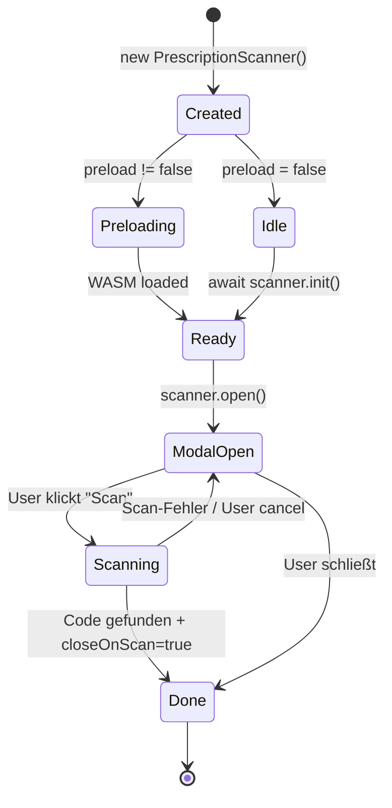

# `PrescriptionScanner` — Modal-Klasse

High-Level-Wrapper mit eingebauter Modal-UI. Für Apps, die schnell einen produktions-tauglichen Scanner einbauen wollen, ohne eigene UI bauen zu müssen.

## Konstruktor

```ts
import { PrescriptionScanner } from 'prescription-scanner';

const scanner = new PrescriptionScanner({
  // Default true. Beeinflusst nicht, ob die Modal-UI angezeigt wird (`open()` rendert immer);
  // sondern markiert den Headless-Use-Case, wenn man scanImage/scanCanvas/start direkt aufruft.
  headless: true,

  // WASM-Preload
  preload: 'idle',                    // 'lazy' | 'idle' | 'eager' | false

  // Formate (default: ['QRCode', 'DataMatrix'])
  formats: ['DataMatrix'],

  // Scan-Bounds (Sub-Region der Kamera)
  scanBounds: { x: 0.1, y: 0.1, width: 0.8, height: 0.8 },

  // WASM-Files-Pfad
  wasmBasePath: '/wasm/',

  // UI-Texte
  title: 'Rezept-Code scannen',
  buttonText: 'Datei wählen',

  // Verhalten
  closeOnScan: true,

  // Callbacks
  onReady:     () => console.log('Scanner bereit'),
  onScan:      (result) => console.log('Code:', result.data),
  onMultiScan: (results) => console.log('Mehrere:', results),
  onError:     (err) => console.error(err),
  onClose:     () => console.log('Modal closed'),
});
```

## Lebenszyklus



## Wichtige Methoden

### `open()`

```ts
await scanner.open();
```

Erzeugt das Modal-DOM, fügt es in `<body>` ein, startet Kamera (wenn `headless=false`).

### `close()`

```ts
scanner.close();
```

Entfernt Modal aus DOM, stoppt Kamera, ruft `onClose` auf.

### `preload()`

```ts
await scanner.preload();
```

Triggert WASM-Load manuell — nützlich bei `preload: false`-Strategie.

### `scanImage(img)` / `scanCanvas(c)` / `scanImageData(d)` / `scanPDF(file)`

Static-Scan-Methoden, identisch zu denen auf `SuperScanner` — aber durch die `PrescriptionScanner`-Instanz erreichbar.

### `setOptions(opts)` — nur auf `SuperScanner`

`setOptions` ist **nicht** direkt auf `PrescriptionScanner` exponiert, sondern auf dem inneren `SuperScanner` (`scanner.ts:388`). Zugriff:

```ts
scanner.scanner?.setOptions({ formats: ['QRCode'] });
// oder einfach: neue PrescriptionScanner-Instanz erzeugen
```

In der Praxis selten gebraucht — Optionen werden meist im Konstruktor festgelegt.

## Modal-UI

Das Modal hat folgende Sektionen:

```
┌─────────────────────────────────────┐
│ ▒▒▒▒▒▒▒ Header ▒▒▒▒▒▒▒          [×] │
│ Rezept-Code scannen                  │
├─────────────────────────────────────┤
│                                     │
│  ┌───────────────────────────────┐  │
│  │  <video> oder Preview-Image   │  │
│  │  Mit ScanBounds-Overlay       │  │
│  └───────────────────────────────┘  │
│                                     │
│  [Datei wählen]   [Kamera starten]  │
│                                     │
│  Status: Scanne...                  │
└─────────────────────────────────────┘
```

CSS in `STYLES`-Constant (~200 Zeilen, inline). Class-Prefix: `ps-` (z.B. `.ps-overlay`, `.ps-modal`).

## Custom Styling

Überschreibe CSS-Klassen in eigener Stylesheet:

```css
.ps-modal {
  background: var(--my-background) !important;
  border-radius: 4px;
}
.ps-title {
  color: var(--my-brand);
}
```

`!important` nötig, weil die Inline-Styles hohe Spezifität haben.

## `openScanner()` — Helper

Ein-Liner für den einfachsten Fall:

```ts
import { openScanner } from 'prescription-scanner';

const result = await openScanner({
  title: 'Rezept scannen',
  formats: ['DataMatrix'],
});

if (result) {
  console.log(result.data);
}
```

Promise resolved mit `ScanResult` bei Success oder `null` bei Close ohne Scan.

## PDF-Support

`scanner.scanPDF(file)` lädt PDF.js **dynamisch von CDN** (cdnjs.cloudflare.com/.../pdf.min.js). Erst beim ersten PDF-Aufruf — nicht im Initial-Bundle.

```ts
const fileInput = document.querySelector('input[type=file]');
fileInput.addEventListener('change', async (e) => {
  const file = e.target.files[0];
  if (file.type === 'application/pdf') {
    const results = await scanner.scanPDF(file);
    results.forEach(r => console.log(r.data));
  }
});
```

Iteriert über alle PDF-Seiten, scannt jede einzeln. Mehrere Codes pro Seite möglich.

## Edge Cases

| Fall | Verhalten |
|------|-----------|
| Browser ohne Camera-API | `isCameraSupported()` → false, Datei-Upload bleibt aktiv |
| Mehrere `open()` parallel | letzter gewinnt — `close()` der vorigen, neuer öffnet |
| PDF mit 50+ Seiten | langsam, kein Cancel — TODO |
| User verweigert Kamera-Permission | `onError` mit `NotAllowedError`, Modal zeigt Fallback-Text |
| Tab geht in Background | Kamera läuft weiter; iOS pausiert Stream automatisch |

## Verwandte Artikel

- [Simple-API](simple-api.md)
- [Preloading](preloading.md)
- [Modal vs. Headless](../architecture/modal-vs-headless.md)
