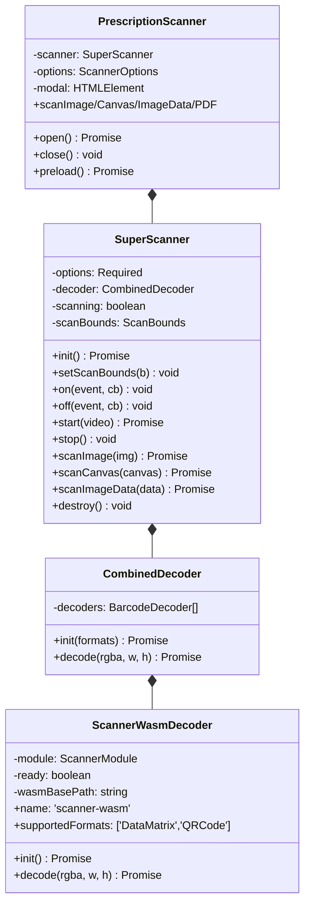

# Klassen-Hierarchie — `SuperScanner` + Decoder

Zwei Layer:

1. **`SuperScanner`** (`src/scanner.ts`) — Low-Level-Engine, Framework-agnostisch
2. **`PrescriptionScanner`** (`src/modal.ts`) — High-Level mit eingebauter Modal-UI

Beide nutzen `CombinedDecoder` → `ScannerWasmDecoder` → WASM-Modul.

## Hierarchie



## `SuperScanner`

`src/scanner.ts:23-` — Kern-Engine.

### Konstruktor

```ts
new SuperScanner({
  formats: ['DataMatrix', 'QRCode'],
  preprocessing: { binarize: 'none', sharpen: false, invert: false },
  camera: { facingMode: 'environment', resolution: { width: 1280, height: 720 }, scanRate: 10 },
  scanBounds: { x: 0.1, y: 0.1, width: 0.8, height: 0.8 },
  wasmBasePath: '/wasm/',
});
```

### Event-System

```ts
scanner.on('scan',  (result: ScanResult) => {})
scanner.on('error', (err: Error) => {})
scanner.on('start', () => {})
scanner.on('stop',  () => {})

// und auch
scanner.off('scan', callback);
```

Multi-Subscribe möglich — intern `Set<callback>`. Auch `off(event, callback)` für Cleanup vorhanden (`scanner.ts:121-130`).

### Continuous-Scanning

```ts
await scanner.init();           // WASM laden
await scanner.start(videoEl);   // startet selbst die Kamera auf dem <video>
// scanner emit 'scan'-Events laufend
scanner.stop();                 // animationFrame stop + stopCamera()
```

Loop nutzt `requestAnimationFrame` mit Throttling auf `scanRate` (Default 10 fps). Die Kamera-Verwaltung übernimmt `SuperScanner` selbst: `start(videoElement)` ruft `startCamera(videoElement, this.options.camera)` auf (`scanner.ts:171-191`), `stop()` stoppt den Stream via `stopCamera()`.

## `CombinedDecoder`

`src/decoder/index.ts` — Wrapper, der **mehrere Decoder** kombinieren könnte. Aktuell aber nur einer (`ScannerWasmDecoder`). Architektur erlaubt später z.B. einen JS-Fallback oder einen anderen WASM-Build zu addieren.

```ts
const decoder = new CombinedDecoder(wasmBasePath);
await decoder.init(['DataMatrix', 'QRCode']);
const results = await decoder.decode(rgba, width, height);
```

## `ScannerWasmDecoder`

`src/decoder/scanner-wasm.ts` — der eigentliche Bridge zum WASM.

### Lade-Logik

```ts
async init() {
  if (this.ready) return;
  if (this.loading) return this.loading;
  this.loading = this.loadModule();
  await this.loading;
}

private async loadModule() {
  await this.loadScript(this.wasmBasePath + 'scanner.js');
  const createScanner = window.createScanner;  // global aus dem geladenen Script
  this.module = await createScanner({
    locateFile: (path) => path.endsWith('.wasm') ? this.wasmBasePath + 'scanner.wasm' : path
  });
  this.ready = true;
}
```

Singleton-Guard via `loading`-Promise → kein doppeltes Laden bei parallelen `init()`-Calls.

### Decode-Call

```ts
async decode(rgba: Uint8ClampedArray, width: number, height: number) {
  const ptr = this.module._malloc(rgba.length);
  this.module.HEAPU8.set(rgba, ptr);
  const results = this.module.scan(ptr, width, height);
  this.module._free(ptr);
  // EmbindVector → array conversion
  return mapped;
}
```

**RGBA direkt durchgereicht** an WASM — keine JS-seitige Grayscale-Konvertierung nötig. Memory-Management explizit via `_malloc`/`_free`.

## `PrescriptionScanner` (Modal)

`src/modal.ts:327` (Datei 1071 Zeilen) — High-Level mit UI:

- Erzeugt Modal-DOM (Header, Close-Button, Video-Container, Datei-Upload, Status-Bar)
- Inline-CSS (`STYLES`-String, ~200 Zeilen)
- Verwaltet WASM-Preloading
- Reicht alle SuperScanner-Methoden weiter
- Schließt sich nach erfolgreichem Scan optional

Details: [Prescription-Scanner-Klasse](../api/prescription-scanner-class.md).

## Wiederverwendbarkeit

```
[zero deps für Code]   →  Library importable in jeder Framework-Umgebung
[singleton WASM]       →  ein Decoder-Load pro Page, mehrere Scanner möglich
[event handlers]       →  React/Vue können einfach via on('scan', cb) andocken
```

## Verwandte Artikel

- [Simple-API](../api/simple-api.md) — minimaler Use-Case
- [Prescription-Scanner-Klasse](../api/prescription-scanner-class.md) — Modal-API
- [WASM-Build](../wasm/wasm-build.md)
- [Preprocessing](../wasm/preprocessing.md)
