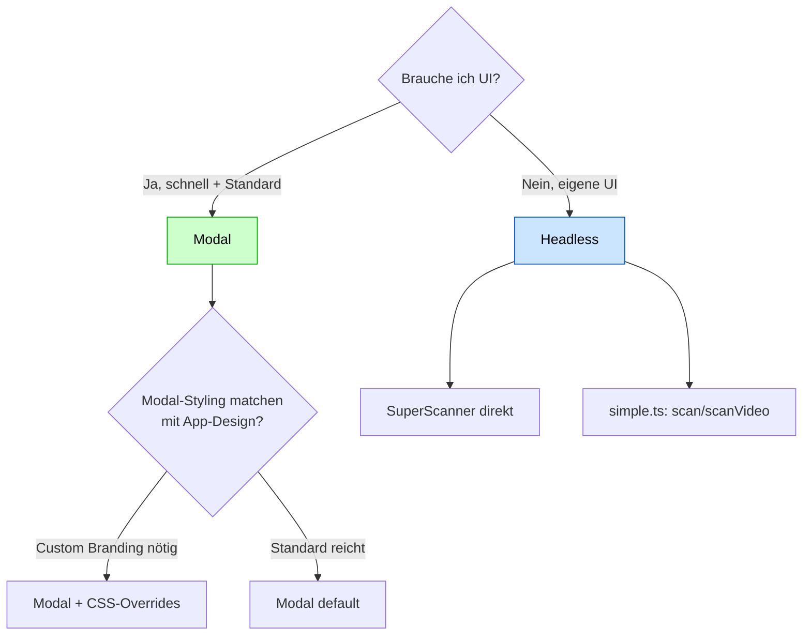

# Modal vs. Headless — Wann was nutzen

Die Library kann auf zwei Arten verwendet werden: **mit eingebauter Modal-UI** oder **Headless** (rein programmatisch).

## Entscheidungsbaum



## Modal-Modus

Klasse: `PrescriptionScanner` (`src/modal.ts`).

**Bekommt**:

- Fertige Overlay-Modal mit Header + Close-Button
- Video-Container für Kamera
- Datei-Upload-Button (Image + PDF)
- Status-Indikator („Scanne…", „Gefunden")
- Inline-CSS — keine Tailwind-Dependency
- Configurable Texte (`title`, `buttonText`)

**Nutzung**:

```ts
import { PrescriptionScanner } from 'prescription-scanner';

const scanner = new PrescriptionScanner({
  preload: 'idle',
  title: 'Rezept-Code scannen',
  closeOnScan: true,
  onScan: (result) => console.log(result.data),
});

await scanner.open();  // zeigt Modal
```

**Ein-Liner mit `openScanner`**:

```ts
import { openScanner } from 'prescription-scanner';
const result = await openScanner();  // returns ScanResult oder null bei Close
```

## Headless-Modus

Direkt mit `SuperScanner` (`src/scanner.ts`) oder den `simple.ts`-Funktionen.

**Bekommt**:

- Reine Programmatik — alle UI selbst bauen
- Mehr Kontrolle (Custom-Layout, Custom-Statusanzeige, A11y)
- Direkter Zugriff auf Event-Stream

**Nutzung**:

```ts
import { SuperScanner } from 'prescription-scanner';

const scanner = new SuperScanner({ formats: ['DataMatrix'] });
await scanner.init();

scanner.on('scan', (result) => {
  myCustomStatusBar.show(result.data);
});

const videoEl = document.querySelector('video');
await scanner.start(videoEl);

// Später:
scanner.stop();
```

Oder Einmal-Scan ohne Klasse:

```ts
import { scan } from 'prescription-scanner';

const result = await scan(myImageElement);
if (result) console.log(result.data);
```

## Vergleichsmatrix

| Aspekt | Modal | Headless |
|--------|:---:|:---:|
| UI eingebaut | ✅ | ❌ (selbst bauen) |
| Customization | mittel (Optionen + CSS-Vars) | hoch |
| Setup-Aufwand | minimal | mittel |
| Bundle-Größe-Beitrag | inkl. UI-CSS ~20 KB | minimal |
| Mobile-optimiert | ✅ | musst du selbst |
| PDF-Upload-UI | ✅ | musst du selbst |
| A11y | basic | nach deinem Standard |
| Branding-Anpassung | über Options + CSS | volle Freiheit |

## Wann was

| Use-Case | Empfehlung |
|----------|------------|
| Schneller PoC | Modal mit `openScanner()` |
| Pharmacy-Web-App, Standard-UX | Modal |
| Mobile-App-Variante mit Custom-Design | Headless |
| Embedded-Scanner in größerer Form | Headless |
| One-Off-Datei-Scan (kein Camera-UI nötig) | `scan(img)` (Headless-Simple) |
| Live-Demo in Storybook | Modal |

## Migration zwischen den Modi

Beide nutzen intern dieselbe `SuperScanner`-Klasse, daher:

```ts
// Modal-Start
const ps = new PrescriptionScanner({ ... });

// Wenn du später Headless gehen willst:
const scanner = new SuperScanner({ ... });
scanner.on('scan', ps.options.onScan);  // gleiche Callbacks
```

Die Public-API (Events, Optionen) ist sehr ähnlich. Refactoring Headless ↔ Modal ist meist nur das Austauschen des Konstruktor-Aufrufs.

## Verwandte Artikel

- [Simple-API](../api/simple-api.md)
- [Prescription-Scanner-Klasse](../api/prescription-scanner-class.md)
- [Preloading](../api/preloading.md)
