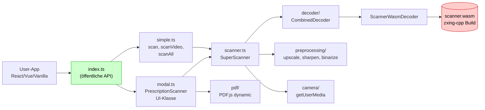

# Systemüberblick — WASM-Barcode-Scanner

`prescription-scanner` ist eine **NPM-Library** für DataMatrix- und QR-Code-Scanning im Browser. **WASM-Modul** (~495 KB, kompiliert aus `zxing-cpp`), **Zero Runtime-Dependencies**, optionale Modal-UI oder rein programmatischer Headless-Modus.

## Pakete + Distribution

| Aspekt | Wert |
|--------|------|
| Name | `prescription-scanner` |
| Version | 1.1.6 |
| Lizenz | MIT AND Apache-2.0 (zxing-cpp Apache-2.0) |
| Bundle | ESM + CJS + Types in `dist/` |
| Browser-Build | `dist/browser/prescription-scanner.js` |
| WASM-Dateien | `dist/scanner.js` (53 KB) + `dist/scanner.wasm` (442 KB) |
| Tree-shaking | `sideEffects: false` |

## High-Level

## Vier Eintrittspunkte

| API | Use-Case |
|-----|----------|
| `scan(source)` | One-Shot-Scan eines Bildes, Canvas oder ImageData |
| `scanAll(source)` | Wie `scan`, aber liefert **alle** Codes im Bild |
| `scanVideo(video, callback)` | Continuous Scanning aus `<video>` |
| `PrescriptionScanner` (`modal.ts`) | Vollständige Modal-UI mit Kamera + Datei-Upload + PDF |
| `SuperScanner` (`scanner.ts`) | Low-Level — eigene UI bauen |

Siehe [Simple-API](../api/simple-api.md) und [Prescription-Scanner-Klasse](../api/prescription-scanner-class.md).

## Drei Source-Typen

| Typ | API |
|-----|-----|
| `HTMLImageElement` | `scan(img)` |
| `HTMLCanvasElement` | `scan(canvas)` |
| `ImageData` | `scan(imageData)` |
| `<video>`-Stream | `scanVideo(video, cb)` oder über `SuperScanner.startCamera()` |
| PDF-File | `scanner.scanPDF(file)` (Modal-Klasse oder direkt) |

## Tech-Stack

| Schicht | Stack |
|---------|-------|
| Build | tsup (esbuild) |
| Tests | Vitest + jsdom |
| WASM-Build | Emscripten + CMake + zxing-cpp |
| PDF | PDF.js (dynamisch von CDN geladen) |
| Demo | Next.js (separates Sub-Projekt `demo/`) |

## Preload-Strategien

WASM ist ~495 KB. Vier Lade-Strategien (für `PrescriptionScanner`-Klasse):

| Strategie | Wann |
|-----------|------|
| `'lazy'` | beim ersten Scan (Default) |
| `'idle'` | beim nächsten `requestIdleCallback` |
| `'eager'` | sofort beim Konstruktor |
| `false` | manuell via `scanner.preload()` |

Wichtig fürs **Pharmacy-UX**: User klickt Button → Scanner soll bereit sein → `'idle'` empfohlen.

Details: [Preloading](../api/preloading.md).

## Nicht-Ziele

- **Kein 1D-Barcode** (EAN, UPC). zxing-cpp ist konfigurierbar, aber unsere Build-Config hat `ZXING_ENABLE_1D=OFF`.
- **Kein Server-Side-Scanning** — Browser-only.
- **Kein Framework-Wrapper** (React-Hooks etc.) — die Lib ist absichtlich Framework-agnostisch.
- **Keine Cloud-Integration** — nicht das Tool für Server-OCR.

## Verwandte Artikel

- [Klassen-Hierarchie](class-hierarchy.md)
- [Simple-API](../api/simple-api.md)
- [WASM-Build](../wasm/wasm-build.md)
- [Modal-vs-Headless](modal-vs-headless.md)
